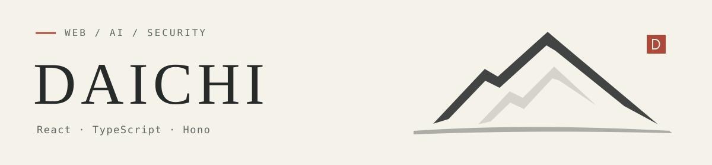

<picture>
  <source media="(prefers-color-scheme: dark)" srcset="./assets/header-dark.svg">
  <source media="(prefers-color-scheme: light)" srcset="./assets/header-light.svg">
  
</picture>

**AIの能力を、安全で直感的なWeb体験へ。**

React / TypeScriptでWebアプリを開発しています。  
質問に応じて変わるUI、MCPによる連携、認証・認可を、個人開発で実装・検証しています。

[Portfolio](https://react-portfolio.cat-and-mountain.com/) · [Zenn](https://zenn.dev/tk_1) · [Qiita](https://qiita.com/tk-111)

## Projects

### [Generative Portfolio](https://generative-portfolio-lab-web.vercel.app/)

質問に合わせて、公開ポートフォリオの見せる項目と順番を変える実験サイト。  
自由なHTMLを生成するのではなく、用意したUI部品を組み合わせて表示します。

`React` `TypeScript` `Hono` `WebMCP`  
[試す ↗](https://generative-portfolio-lab-web.vercel.app/) · [制作の背景](https://zenn.dev/tk_1/articles/cd4c88ce8d88ab) · [比較して見えた課題](https://zenn.dev/tk_1/articles/fe3e547047a472)

### [体験ノート](https://react-portfolio.cat-and-mountain.com/portfolio/1)

やりたいことを記録し、経験したことを残すWebアプリ。  
Reactの画面とHonoのAPIをCloudflareにデプロイ。記録・管理は本人専用とし、体験のページを一般公開しています。

`React` `TypeScript` `Hono` `Cloudflare`  
[公開ページ ↗](https://experience-note.cat-and-mountain.com/) · [作品紹介](https://react-portfolio.cat-and-mountain.com/portfolio/1)

## Experiments

### [Work Report MCP](https://github.com/daichitk1/work-report-mcp-example)

ChatGPTの1件の依頼に対する作業結果を、結果・判断・確認状況に分けて表示するMCP App。  
ReactのUIとHonoのMCP Serverを実装し、Auth0のOAuthでアクセスを制御しています。

`MCP Apps` `React` `Hono` `Auth0`  
[Code](https://github.com/daichitk1/work-report-mcp-example) · [実装記事](https://qiita.com/tk-111/items/f4dfa27f12f4718a9aa6)

### [AuthZEN × Cerbos](https://github.com/daichitk1/authzen-hono-cerbos-example)

認可を判断するCerbosと、操作を制御するHonoの役割を分けたローカルデモ。  
許可・拒否・判断不能を区別し、拒否や障害時には操作が進まないことをテストしています。

`AuthZEN` `Cerbos` `Hono` `React`  
[Code](https://github.com/daichitk1/authzen-hono-cerbos-example) · [設計と役割分担](https://zenn.dev/tk_1/articles/32f7aa975066af)

## Stack

| 領域 | 作品で使っている技術 |
| :--- | :--- |
| Interface | React · TypeScript · Vite · Tailwind CSS |
| API & Auth | Hono · Auth0 · OAuth 2.0 · AuthZEN · Cerbos |
| AI Integration | MCP · MCP Apps · WebMCP |
| Deployment | Cloudflare · Vercel |

## Writing

作ったものと、試して分かったことを書いています。

- [ChatGPTのIntelligent UIと自作Generative UIを比較して見えた3つの課題](https://zenn.dev/tk_1/articles/fe3e547047a472)
- [WebMCPを使ったあとに「MCPでもよくない？」と思った](https://zenn.dev/tk_1/articles/e3822bb089197d)
- [認可をアプリから分離すると何が変わる？Hono + AuthZEN + Cerbosで見る認可の役割分担](https://zenn.dev/tk_1/articles/32f7aa975066af)

---

制作物と記事の一覧は <a href="https://react-portfolio.cat-and-mountain.com/">Portfolio</a> にまとめています。
