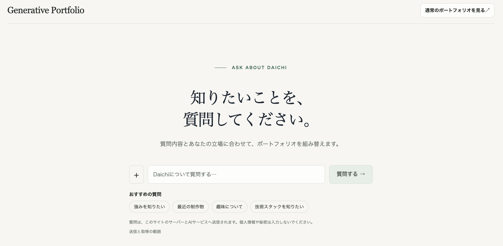

<a href="https://react-portfolio.cat-and-mountain.com/">
  <picture>
    <source media="(max-width: 640px)" srcset="./assets/profile-header-mobile.webp">
    
  </picture>
</a>

React / TypeScriptでWeb開発。  
Generative UI・MCP・認証と認可を実装・検証しています。

**[Portfolio](https://react-portfolio.cat-and-mountain.com/)**　/　[Zenn](https://zenn.dev/tk_1)　/　[Qiita](https://qiita.com/tk-111)

## Tech stack

  &nbsp;&nbsp;
  &nbsp;&nbsp;
  &nbsp;&nbsp;
  
   
  TypeScript / React / Hono / Vite

  &nbsp;&nbsp;
  &nbsp;&nbsp;
  &nbsp;&nbsp;
  
   
  Tailwind&nbsp;CSS / Cloudflare / Vercel / Auth0

MCP・MCP Apps・WebMCP、AuthZEN・Cerbosも制作物で使っています。

## Projects

### [Generative Portfolio](https://generative-portfolio-lab-web.vercel.app/)

質問に合わせて、公開情報とUI部品から画面を組み立てる実験サイト。

React / Hono / WebMCP  
[試す](https://generative-portfolio-lab-web.vercel.app/) · [制作の背景](https://zenn.dev/tk_1/articles/cd4c88ce8d88ab)

### [体験ノート](https://react-portfolio.cat-and-mountain.com/portfolio/1)

やりたいことと、経験したことを残すWebアプリ。体験ページを公開し、記録・管理は本人専用にしています。

React / Hono / Cloudflare  
[公開ページ](https://experience-note.cat-and-mountain.com/) · [作品紹介](https://react-portfolio.cat-and-mountain.com/portfolio/1)

## Experiments

**[Work Report MCP](https://github.com/daichitk1/work-report-mcp-example)**  
ChatGPTの作業結果を、結果・判断・確認状況に分けて表示するMCP App。HonoのMCP ServerにAuth0のOAuthを組み込んでいます。  
MCP Apps / React / Hono / Auth0 · [実装記事](https://qiita.com/tk-111/items/f4dfa27f12f4718a9aa6)

**[AuthZEN × Cerbos](https://github.com/daichitk1/authzen-hono-cerbos-example)**  
認可を判断するCerbosと、操作を制御するHonoの役割を分けたローカルデモ。拒否・障害時に操作が進まないことを検証しています。  
AuthZEN / Cerbos / Hono / React · [設計と役割分担](https://zenn.dev/tk_1/articles/32f7aa975066af)

## Public activity

<a href="https://github.com/daichitk1?tab=repositories">
  <picture>
    <source media="(prefers-color-scheme: dark)" srcset="https://github-stats-extended.vercel.app/api?username=daichitk1&amp;hide_rank=true&amp;hide=stars%2Cissues%2Ccontribs&amp;show_icons=true&amp;count_private=false&amp;include_all_commits=false&amp;card_width=320&amp;line_height=28&amp;border_radius=0&amp;custom_title=Public%20GitHub%20activity&amp;bg_color=0d1117&amp;title_color=d9e6df&amp;text_color=abbab4&amp;icon_color=75a995&amp;border_color=30363d">
    
  </picture>
</a>

<a href="https://github.com/daichitk1?tab=repositories">
  <picture>
    <source media="(prefers-color-scheme: dark)" srcset="https://github-stats-extended.vercel.app/api/top-langs/?username=daichitk1&amp;layout=compact&amp;langs_count=6&amp;card_width=320&amp;border_radius=0&amp;custom_title=Public%20code%20languages&amp;bg_color=0d1117&amp;title_color=d9e6df&amp;text_color=abbab4&amp;icon_color=75a995&amp;border_color=30363d">
    
  </picture>
</a>

公開データのみの集計です。言語比率はコード量を示し、習熟度ではありません。画像を表示できない場合は、[公開リポジトリ](https://github.com/daichitk1?tab=repositories)をご覧ください。

## Writing

- [Generative UIを比較して見えた3つの課題](https://zenn.dev/tk_1/articles/fe3e547047a472)
- [MCPとWebMCPの使い分けを考える](https://zenn.dev/tk_1/articles/e3822bb089197d)
- [Hono・AuthZEN・Cerbosで認可の役割を分ける](https://zenn.dev/tk_1/articles/32f7aa975066af)
